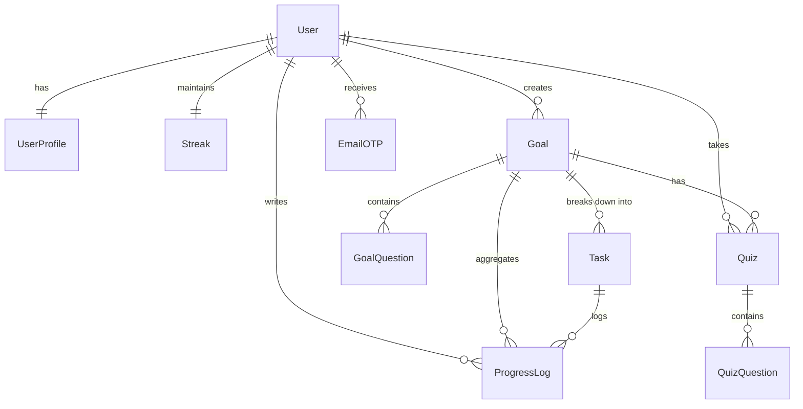

# 🌌 Nebula Planner — AI-Powered Learning & Goal Tracker

> **Definitive Master Guide for Developers and AI Instances**
> This file contains the complete architecture, data models, authentication mechanisms, API catalog, frontend structure, and operational runbook for the **Nebula Planner** project. Any new developer or agent instance can read this document to understand the codebase.

---

## 📑 Table of Contents
1. [Project Overview](#1-project-overview)
2. [Tech Stack](#2-tech-stack)
3. [Repository Directory Tree](#3-repository-directory-tree)
4. [Data Models & Schema](#4-data-models--schema)
5. [Authentication & Security Architecture](#5-authentication--security-architecture)
6. [API Endpoints Catalog](#6-api-endpoints-catalog)
7. [Frontend Architecture & UI System](#7-frontend-architecture--ui-system)
8. [Setup & Local Development Runbook](#8-setup--local-development-runbook)
9. [Verification & Testing Guide](#9-verification--testing-guide)

---

## 1. Project Overview

**Nebula Planner** is an intelligent web application designed to help users break down ambitious learning goals into daily actionable steps, track habit streaks, record detailed progress logs, generate quizzes based on learning notes, and visualize analytics.

### Core Capabilities:
- **AI-Powered Learning Roadmaps**: Automatically generates structured daily tasks and prerequisite questions for any learning objective.
- **Smart Progress Logging & Notes**: Captures what the user learned, roadblocks faced, and key insights per task and goal.
- **AI Quiz Generation**: Generates 4-choice interactive quizzes directly from user notes to reinforce retention.
- **Streak & Habit Engine**: Automatically updates active and longest streaks upon completing daily tasks.
- **Multi-Mode Authentication**: Supports Standard Password login, Passwordless Email OTP, Two-Factor Authentication (2FA), Google OAuth 2.0 / GIS, and self-service Password Reset.
- **Analytics & PDF Export**: Provides visual completion heatmaps, statistics, and downloadable PDF roadmap summaries.

---

## 2. Tech Stack

| Layer | Technologies |
|---|---|
| **Backend Framework** | Django 5.2 (Python 3.12) |
| **API Layer** | Django REST Framework (DRF), Session Authentication, CSRF Protection |
| **Database** | SQLite (Default for development) / PostgreSQL ready |
| **Static & Assets** | WhiteNoise, Custom CSS Design System, Lucide Icons |
| **Frontend UI** | HTML5 Templates, Vanilla JavaScript (ES6+), Bootstrap 5.3 |
| **AI Integration** | Google Gemini API (Task decomposition, adaptive questioning, quiz generation) |
| **Auth Subsystems** | Google Identity Services (GIS) ID Tokens + OAuth2 redirect, Email OTP (Console / SMTP) |

---

## 3. Repository Directory Tree

```
django-project/
├── manage.py                   # Django CLI entrypoint
├── requirements.txt            # Python dependencies
├── db.sqlite3                  # Development SQLite database
├── .env                        # Environment variables (OAuth, Secret keys, SMTP)
│
├── config/                     # Core Project Configuration
│   ├── settings.py             # Global Django & third-party settings
│   ├── urls.py                 # Top-level URL routing (Pages + API routes)
│   ├── wsgi.py                 # WSGI application callable
│   └── asgi.py                 # ASGI application callable
│
├── tracker/                    # Main Application
│   ├── models.py               # Data models (Goal, Task, Streak, UserProfile, EmailOTP, Quiz, Note)
│   ├── serializers.py          # DRF Serializers
│   ├── signals.py              # Automatic Profile & Streak creation on User post_save
│   ├── urls.py                 # API v1 endpoints (`/api/v1/...`)
│   ├── prompt.py               # System prompts for AI roadmap & quiz generation
│   ├── ai_helper.py            # AI integration helpers
│   ├── admin.py                # Django Admin registrations
│   │
│   ├── views/                  # Modular View Controllers
│   │   ├── auth_views.py       # Login, Register, OTP, 2FA, Google OAuth, Password Reset
│   │   ├── dashboard_views.py  # Template rendering views (Dashboard, Login, Analytics, Notes, Quiz)
│   │   ├── task_views.py       # Goal CRUD, Task completion, PDF generation
│   │   ├── streak_views.py     # User streak stats & analytics aggregation
│   │   ├── note_views.py       # Progress logs & learning reflections
│   │   └── quiz_views.py       # AI quiz generation, submission & scoring
│   │
│   └── services/               # Reusable Business Logic Services
│       ├── otp_service.py      # OTP generation, rate-limiting, email delivery, verification
│       └── google_auth_service.py # Google GIS ID token verification & OAuth2 code exchange
│
├── templates/                  # Frontend HTML Templates
│   ├── base.html               # Master layout (Navigation, CSRF, Toast system, Cursor effects)
│   ├── login.html              # Multi-mode Auth UI (Sign In, OTP, Register, 2FA, Reset)
│   ├── dashboard.html          # Main Task Tracking & Goal Management Dashboard
│   ├── analytics.html          # Streak & Completion Analytics Page
│   ├── goal_notes.html         # Goal Notes & Reflection Workspace
│   └── quiz.html               # Interactive AI Quiz Arena
│
└── static/                     # Static CSS & Assets
    └── css/
        ├── base.css            # Global CSS variables, reset, glass panels, buttons, toast
        ├── login.css           # Proportional auth card, 60% viewport / 80% content styling
        ├── dashboard.css       # Split-pane dashboard, task checklist, streak card
        ├── analytics.css       # Charts, metrics cards, streak history
        ├── goal_notes.css      # Markdown note editor and log feed
        └── quiz.css            # Quiz card, options selector, feedback UI
```

---

## 4. Data Models & Schema



### Model Reference:
1. **`UserProfile`**: Extends Django's `User` with `is_2fa_enabled` (boolean) and `google_id` (string).
2. **`Streak`**: Tracks `current_streak`, `longest_streak`, and `last_activity_date`. Updates automatically when a task is completed.
3. **`Goal`**: Learning roadmap entity (`title`, `experience_level`, `total_days`, `schedule_type`, `frequency_days_per_week`, `duration_weeks`, `is_ai`).
4. **`GoalQuestion`**: Clarifying onboarding questions generated for a goal (`question_text`, `answer_text`, `order`).
5. **`Task`**: Discrete daily milestone (`title`, `description`, `scheduled_date`, `order_index`, `is_completed`, `completed_at`, `is_user_added`).
6. **`ProgressLog`**: Daily learning notes linked to a task or goal (`learned`, `problems_faced`, `additional_notes`, `log_date`).
7. **`Quiz` & `QuizQuestion`**: AI-generated assessment with 4 multiple choice options, `correct_option_index`, `user_answer_index`, `score`, and `explanation`.
8. **`EmailOTP`**: Single-use 6-digit cryptographic codes with expiration timestamps for `PASSWORDLESS`, `LOGIN_2FA`, and `PASSWORD_RESET`.

---

## 5. Authentication & Security Architecture

### Supported Auth Methods:
1. **Password Sign In & Registration**:
   - Standard username/password login. Supports signing in using either **Username** or **Email**.
   - If user has enabled 2FA, password validation responds with a cryptographic session token and triggers a 2FA OTP code sent to the email.
2. **Passwordless Email OTP**:
   - User inputs email $\rightarrow$ System generates a 6-digit code (valid for 10 minutes) $\rightarrow$ User submits code $\rightarrow$ Logged in. New users are automatically registered.
   - Built-in rate limiting prevents re-requesting within 60 seconds.
3. **Two-Factor Authentication (2FA)**:
   - Users can toggle 2FA directly from the dashboard header button.
   - Handled via signed tokens (`django.core.signing`) with short TTL.
4. **Google Sign-In (Dual Modes)**:
   - **Mode A (GIS One-Tap / ID Token)**: Uses Google Identity Services to post the credential JWT directly to `/api/v1/auth/google/`.
   - **Mode B (OAuth2 Authorization Code)**: Redirect flow via `/api/v1/auth/google/login/` and callback `/api/v1/auth/google/callback/`.
5. **Self-Service Password Reset**:
   - In-page OTP verification without external reset links. Validates against Django's password validation rules.

---

## 6. API Endpoints Catalog

All API endpoints are prefixed with `/api/v1/`.

### Authentication (`tracker/views/auth_views.py`):
| Method | Endpoint | Description | Auth Required |
|---|---|---|---|
| `POST` | `/api/v1/auth/register/` | Register new user account | No |
| `POST` | `/api/v1/auth/login/` | Sign in with username/email & password | No |
| `POST` | `/api/v1/auth/login/verify-2fa/` | Complete 2FA challenge with OTP | No |
| `POST` | `/api/v1/auth/otp/send/` | Request passwordless login OTP | No |
| `POST` | `/api/v1/auth/otp/verify/` | Verify passwordless OTP and login | No |
| `POST` | `/api/v1/auth/password-reset/send-otp/` | Request password reset code | No |
| `POST` | `/api/v1/auth/password-reset/confirm/` | Confirm OTP & set new password | No |
| `POST` | `/api/v1/auth/google/` | Verify Google GIS ID Token | No |
| `GET` | `/api/v1/auth/google/login/` | Initiate Google OAuth2 redirect | No |
| `GET` | `/api/v1/auth/google/callback/` | Google OAuth2 code callback | No |
| `POST` | `/api/v1/auth/user/2fa/toggle/` | Toggle 2FA on/off for current user | Yes |
| `POST` | `/api/v1/auth/logout/` | Terminate session & log out | Yes |
| `GET` | `/api/v1/auth/user/` | Get current logged-in user details | Yes |

### Goals & Tasks (`tracker/views/task_views.py`):
| Method | Endpoint | Description | Auth Required |
|---|---|---|---|
| `GET`, `POST` | `/api/v1/goals/` | List user goals or create a new goal | Yes |
| `GET`, `DELETE` | `/api/v1/goals/<goal_id>/` | Goal details or delete goal | Yes |
| `GET`, `POST` | `/api/v1/goals/<goal_id>/questions/` | Get or submit onboarding answers | Yes |
| `GET` | `/api/v1/goals/<goal_id>/tasks/` | List tasks for a specific goal | Yes |
| `POST` | `/api/v1/goals/<goal_id>/tasks/create/` | Add a custom manual task | Yes |
| `GET` | `/api/v1/goals/<goal_id>/pdf/` | Download structured PDF roadmap | Yes |
| `PATCH` | `/api/v1/tasks/<task_id>/` | Update task title/description | Yes |
| `POST` | `/api/v1/tasks/<task_id>/complete/` | Toggle completion & increment streak | Yes |

### Quizzes, Notes & Analytics:
| Method | Endpoint | Description | Auth Required |
|---|---|---|---|
| `POST` | `/api/v1/goals/<goal_id>/quiz/generate/` | Generate 5-question AI quiz | Yes |
| `GET` | `/api/v1/quizzes/<quiz_id>/` | Fetch quiz questions & user choices | Yes |
| `POST` | `/api/v1/quizzes/<quiz_id>/submit/` | Submit answers, calculate score | Yes |
| `GET`, `POST` | `/api/v1/tasks/<task_id>/logs/` | Task-level progress logs | Yes |
| `GET` | `/api/v1/goals/<goal_id>/logs/` | Goal-level aggregated logs | Yes |
| `PATCH` | `/api/v1/logs/<log_id>/` | Edit existing progress log | Yes |
| `GET` | `/api/v1/user/streak/` | Current and longest streak stats | Yes |
| `GET` | `/api/v1/user/analytics/` | Detailed completion rate & metrics | Yes |

---

## 7. Frontend Architecture & UI System

### Design Tokens (`static/css/base.css`):
- **Background**: `--bg-body: #F8EDE3;` (Warm parchment), `--bg-panel: #FCF9F6;` (Soft card panel)
- **Primary Accents**: `--accent-primary: #798777;`, `--accent-dark: #5A6658;`, `--accent-secondary: #A2B29F;`
- **Text Palette**: `--text-primary: #2C352B;`, `--text-secondary: #5C695A;`, `--text-muted: #8A9887;`
- **Typography**: Outfit for display titles, Inter for body and form controls.

### Auth Card Geometry & Layout:
- **Card Wrapper (`.auth-wrapper`)**: Proportioned to **60% width** on standard desktop viewports (leaving 20% margin on the left and 20% on the right).
- **Inner Content Box (`.auth-content-box`)**: Proportioned to **80% width** within the card (leaving 10% inner padding on the left and 10% on the right).
- **Mobile Adaptation**: Smoothly scales to 92-96% width on small mobile screens.

### Global Client-Side Helpers (`templates/base.html`):
- `apiRequest(endpoint, method, body, throwError)`: Centralized async fetch wrapper that automatically handles CSRF injection, session expiry, and error toast formatting.
- `showToast(message, type)`: Animated non-blocking notification toast.
- `handleToggle2FA()`: Live toggle for Two-Factor Authentication in the header.

---

## 8. Setup & Local Development Runbook

### Step 1: Environment Configuration
Create a `.env` file in the project root:
```ini
SECRET_KEY=your-secret-django-key
DEBUG=True
ALLOWED_HOSTS=127.0.0.1,localhost

# Google OAuth Credentials (Optional - Google Cloud Console)
GOOGLE_CLIENT_ID=
GOOGLE_CLIENT_SECRET=

# Email Backend (Console backend by default for local development)
EMAIL_BACKEND=django.core.mail.backends.console.EmailBackend
EMAIL_HOST=smtp.gmail.com
EMAIL_PORT=587
EMAIL_USE_TLS=True
EMAIL_HOST_USER=
EMAIL_HOST_PASSWORD=
DEFAULT_FROM_EMAIL=Nebula Planner <noreply@nebulaplanner.com>

# AI API Key (Optional)
GEMINI_API_KEY=
```

### Step 2: Database Migration & Setup
```bash
# 1. Run migrations
python manage.py migrate

# 2. Collect static files (if needed)
python manage.py collectstatic --noinput

# 3. Create a superuser
python manage.py createsuperuser
```

### Step 3: Run Development Server
```bash
python manage.py runserver
```
Visit `http://127.0.0.1:8000/` in your browser.

---

## 9. Verification & Testing Guide

### Automated Testing:
```bash
python manage.py test tracker
```

### Manual Verification Checklist:
1. **Password Authentication**: Navigate to `/login/`, sign up as a new user, log out, and sign back in.
2. **Passwordless OTP**: Go to the **Email OTP** tab, enter your email, grab the 6-digit code printed in the server terminal, and verify instant login.
3. **2FA Flow**: Toggle 2FA in the dashboard header, log out, attempt password login, and verify that the 2FA verification challenge screen appears.
4. **Password Reset**: Click *Forgot Password?*, input your email, provide the OTP code from the console, and set a new password.
5. **Task & Streak**: Create a goal, complete a task, and verify that the streak counter increments in real time.

---

*Authored for the Nebula Planner Core Team. Keep this file updated whenever new models or services are introduced.*
