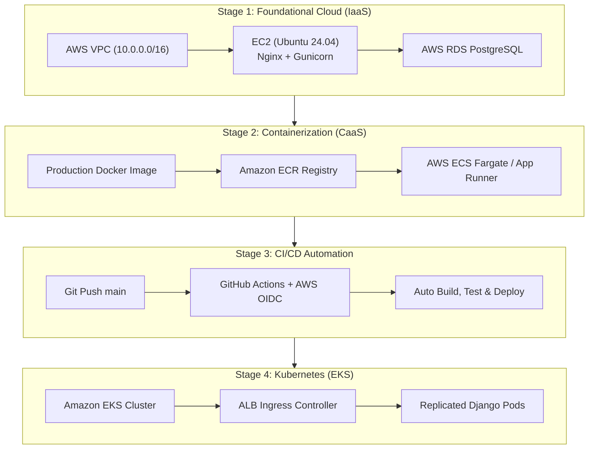

# ☁️ AWS Cloud Mastery & Deployment Guides

Welcome to your hands-on training repository for deploying this Django application to AWS. These guides are structured to take you from core cloud infrastructure all the way to Kubernetes orchestration.

---

## 📚 Table of Contents

| Guide | Topic | Description |
| :--- | :--- | :--- |
| **[00. Prerequisites & IAM](00_AWS_PREREQUISITES_IAM.md)** | Cloud Security & Setup | IAM User, Access Keys, AWS CLI configuration, Free Tier cost controls. |
| **[01. Stage 1: Traditional Cloud](01_STAGE1_TRADITIONAL_EC2_RDS.md)** | EC2, VPC & RDS | Custom VPC, Subnets, Security Groups, RDS PostgreSQL, Gunicorn, Nginx, SSL. |
| **[02. Stage 2: Containerized Cloud](02_STAGE2_DOCKER_ECR_ECS.md)** | Docker & ECS Fargate | Multi-stage Dockerfile, Amazon ECR, Serverless containers on ECS / App Runner. |
| **[03. Stage 3: Automated CI/CD](03_STAGE3_GITHUB_ACTIONS_CICD.md)** | GitHub Actions + OIDC | Automated testing, ECR build/push, Zero-downtime rolling deployments without static keys. |
| **[04. Stage 4: Cloud Kubernetes](04_STAGE4_KUBERNETES_EKS.md)** | Amazon EKS & Helm | Deployments, Services, Ingress, ConfigMaps, Secrets, and EKS Cluster orchestration. |

---

## 🗺️ Architectural Progression

---

## 🚦 Recommended Next Step
Start with **[00_AWS_PREREQUISITES_IAM.md](00_AWS_PREREQUISITES_IAM.md)** to configure your IAM credentials and AWS CLI.
